# E-Learning Platform - Final UML (Week 4)

This diagram matches the final merged production source after PR #11. It contains all 17 production classes.

```mermaid
classDiagram
direction LR

class Course {
  -String id
  -String title
  -List~Lesson~ lessons
  +Course(String id, String title)
  +String getId()
  +String getTitle()
  +void addLesson(Lesson lesson)
  +List~Lesson~ getLessons()
}

class Lesson {
  <<abstract>>
  -String id
  -String title
  -Lesson prerequisite
  +Lesson(String id, String title)
  +String getId()
  +String getTitle()
  +Lesson getPrerequisite()
  +void setPrerequisite(Lesson prerequisite)
  +boolean isComplete(CompletionEvidence evidence)*
}

class VideoLesson {
  -double requiredWatchPercent
  +VideoLesson(String id, String title, double requiredWatchPercent)
  +double getRequiredWatchPercent()
  +boolean isComplete(CompletionEvidence evidence)
}
class TextLesson {
  +TextLesson(String id, String title)
  +boolean isComplete(CompletionEvidence evidence)
}
class QuizLesson {
  -double minimumScore
  +QuizLesson(String id, String title, double minimumScore)
  +double getMinimumScore()
  +boolean isComplete(CompletionEvidence evidence)
}
class AssignmentLesson {
  -int minimumWordCount
  +AssignmentLesson(String id, String title, int minimumWordCount)
  +int getMinimumWordCount()
  +boolean isComplete(CompletionEvidence evidence)
}

class CompletionEvidence {
  <<interface>>
}
class VideoEvidence {
  -double watchedPercent
  +VideoEvidence(double watchedPercent)
  +double getWatchedPercent()
}
class TextEvidence {
  -boolean completedReading
  +TextEvidence(boolean completedReading)
  +boolean isCompletedReading()
}
class QuizEvidence {
  -double score
  +QuizEvidence(double score)
  +double getScore()
}
class AssignmentEvidence {
  -int submittedWordCount
  +AssignmentEvidence(int submittedWordCount)
  +int getSubmittedWordCount()
}

class PercentageValidator {
  <<package-private>>
  -PercentageValidator()
  +requireValid(double value, String fieldName) void
}

class Student {
  -String studentId
  -String name
  +Student(String studentId, String name)
  +String getStudentId()
  +String getName()
  +Enrollment enroll(Course course)
}
class Instructor {
  -String id
  -String name
  +Instructor(String id, String name)
  +String getId()
  +String getName()
  +Course createCourse(String courseId, String title)
}
class Enrollment {
  -Student student
  -Course course
  -Progress progress
  +Enrollment(Student student, Course course)
  +restore(Student student, Course course, Collection~String~ completedLessonIds) Enrollment
  +Student getStudent()
  +Course getCourse()
  +Progress getProgress()
}
class Progress {
  -Course course
  -Set~Lesson~ completedLessons
  +Progress(Course course)
  +restore(Course course, Collection~String~ completedLessonIds) Progress
  +boolean isLessonCompleted(Lesson lesson)
  +boolean isLessonUnlocked(Lesson lesson)
  +boolean updateLessonProgress(Lesson lesson, CompletionEvidence evidence)
  +double getOverallPercentage()
  +boolean isCertificateEligible()
}
class EnrollmentFileStore {
  +void save(Path path, Enrollment enrollment)
  +Enrollment load(Path path, Student student, Course course)
}

Lesson <|-- VideoLesson
Lesson <|-- TextLesson
Lesson <|-- QuizLesson
Lesson <|-- AssignmentLesson

CompletionEvidence <|.. VideoEvidence
CompletionEvidence <|.. TextEvidence
CompletionEvidence <|.. QuizEvidence
CompletionEvidence <|.. AssignmentEvidence

Course "1" *-- "0..*" Lesson : contains ordered lessons
Lesson "0..1" --> "0..1" Lesson : prerequisite

Student --> Enrollment : enroll()
Instructor --> Course : createCourse()
Enrollment --> Student
Enrollment --> Course
Enrollment "1" *-- "1" Progress
Progress --> Course
Progress --> Lesson : tracks completed
Progress ..> CompletionEvidence : completion input

VideoLesson ..> VideoEvidence : uses
TextLesson ..> TextEvidence : uses
QuizLesson ..> QuizEvidence : uses
AssignmentLesson ..> AssignmentEvidence : uses

VideoLesson ..> PercentageValidator : validates
QuizLesson ..> PercentageValidator : validates
VideoEvidence ..> PercentageValidator : validates
QuizEvidence ..> PercentageValidator : validates

EnrollmentFileStore ..> Enrollment : save / restore
EnrollmentFileStore ..> Student : validates
EnrollmentFileStore ..> Course : validates
```

## Week 4 extension evidence

The Week 4 Assignment extension was introduced in feature commit 3a64498 with only three added files and no modifications to existing core classes:

- src/main/java/elearning/lesson/AssignmentEvidence.java
- src/main/java/elearning/lesson/AssignmentLesson.java
- src/test/java/elearning/lesson/AssignmentLessonExtensibilityTest.java

This is the direct Open/Closed Principle evidence required by the Week 4 rubric.
